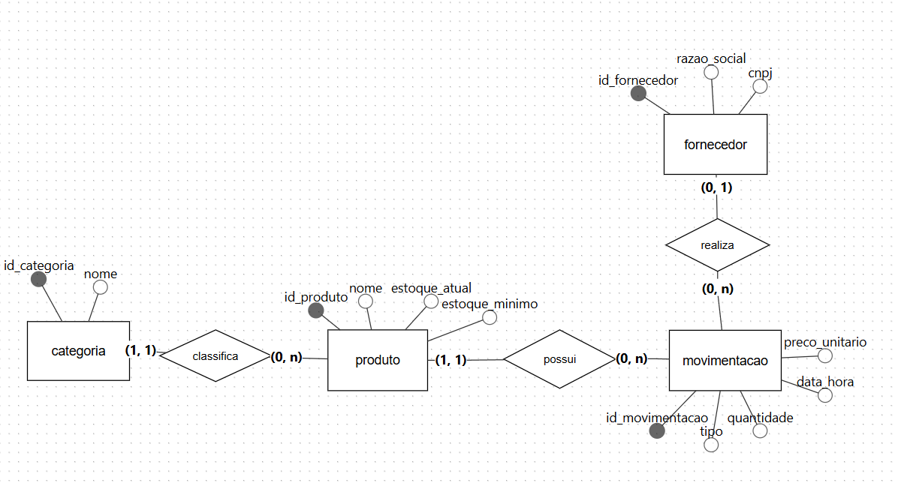
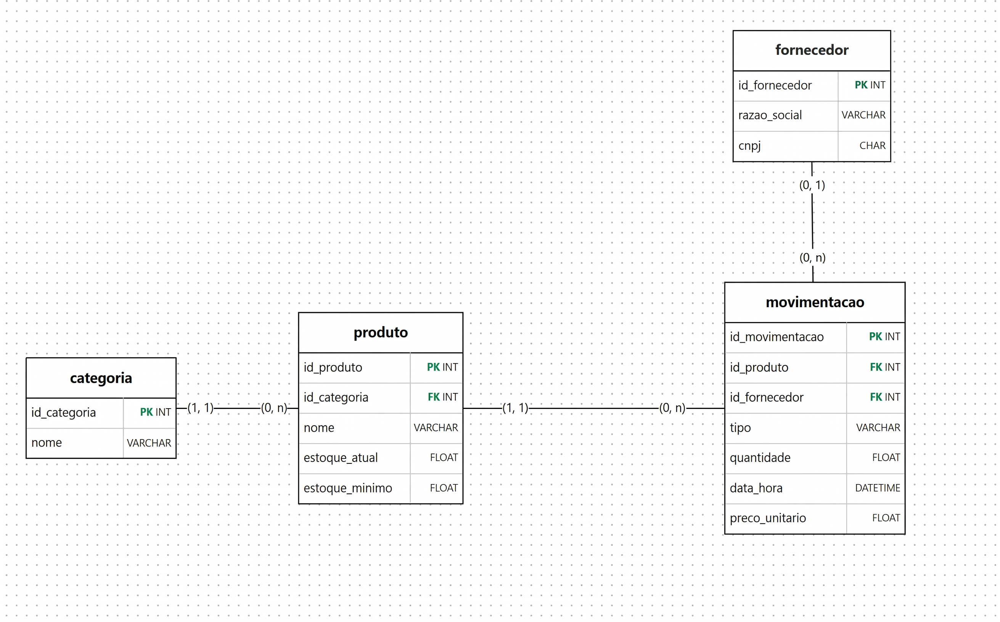

# Controle de Estoque para Pequeno Comércio

**Disciplina:** Banco de Dados I – Análise e Desenvolvimento de Sistemas (ADS)
**Instituição:** FATEC Ribeirão Preto
**Professora:** Eliza Bomfim
**Tema:** 5 – Estoque de Pequeno Comércio
**SGBD:** Oracle

**Integrantes do grupo:**
* Gabriel Stopa Honorato Rocha
* João Victor Tavares
* João Vitor de Freitas Barbosa
* Nicolas Teófilo de Castro
* Thiago Henrique dos Reis Martins

---

## Sumário
1. [Quem utilizará as informações](#1-quem-utilizará-as-informações-armazenadas-no-banco-de-dados)
2. [Problema a ser resolvido](#2-qual-problema-de-organização-consulta-ou-controle-de-dados-será-resolvido)
3. [Entidades e informações](#3-quais-entidades-e-informações-precisam-ser-registradas)
4. [Relacionamentos](#4-como-essas-informações-se-relacionam)
5. [Restrições e regras de negócio](#5-quais-restrições-de-integridade-e-regras-de-negócio-precisam-ser-respeitadas)
6. [Consultas e relatórios úteis](#6-quais-consultas-e-relatórios-seriam-úteis-para-apoiar-as-atividades-ou-decisões-do-usuário)
7. [Modelagem conceitual (DER)](#7-modelagem-conceitual-der)
8. [Modelo lógico/relacional](#8-modelo-lógicorelacional)
9. [Dicionário de dados](#9-dicionário-de-dados)
10. [Normalização](#10-normalização)
11. [Consultas SQL](#11-consultas-sql-04_consultassql)
12. [Objetos PL/SQL](#12-objetos-plsql-05_plsqlsql)
13. [Como criar e testar o banco no Oracle](#13-como-criar-e-testar-o-banco-no-oracle)

---

## 1. Quem utilizará as informações armazenadas no banco de dados?
O banco de dados será utilizado pelo proprietário do comércio, que também é o responsável pelo controle operacional do estoque. Ele registra diretamente o que entra e sai da loja e utiliza as informações geradas para decidir quando, quanto e de qual fornecedor realizar novas compras.

## 2. Qual problema de organização, consulta ou controle de dados será resolvido?
O sistema busca resolver problemas de controle manual do estoque, como a falta de visibilidade sobre a quantidade disponível de cada produto, a dificuldade para identificar itens com saldo abaixo do estoque mínimo, compras desorganizadas e a perda do histórico de entradas e saídas. Com esta solução, o proprietário consegue responder rapidamente a perguntas essenciais para a gestão do negócio, tais como:
* Quais produtos precisam de reposição?
* Quanto foi gasto com cada fornecedor?
* Quais produtos estão parados (sem saídas)?
* Qual é o saldo atual de cada produto?

## 3. Quais entidades e informações precisam ser registradas?
* **Categoria:** identificador e nome da categoria.
* **Fornecedor:** identificador, razão social e CNPJ.
* **Produto:** identificador, nome, estoque atual, estoque mínimo e a categoria à qual pertence (chave estrangeira).
* **Movimentação:** identificador, produto, tipo (ENTRADA ou SAIDA), quantidade, data e hora da operação e, exclusivamente nas entradas, o fornecedor e o preço unitário.

## 4. Como essas informações se relacionam?
* **Categoria e Produto (1 para N):** uma categoria classifica de zero a vários produtos, e cada produto pertence a exatamente uma categoria (cardinalidades `1,1` e `0,n`).
* **Produto e Movimentação (1 para N):** um produto possui de zero a várias movimentações ao longo do tempo, e cada movimentação está vinculada a exatamente um produto (`1,1` e `0,n`).
* **Fornecedor e Movimentação (1 para N):** um fornecedor realiza de zero a várias movimentações de entrada, e cada movimentação é realizada por no máximo um fornecedor (`0,1` e `0,n`). O fornecedor é opcional porque as saídas ocorrem dentro da loja, sem fornecedor associado.

## 5. Quais restrições de integridade e regras de negócio precisam ser respeitadas?

| # | Regra de negócio | Como foi garantida |
|---|---|---|
| 1 | O estoque atual do produto não pode ficar negativo. | `CHECK` em PRODUTO e trigger (erro ORA-20001 na saída sem saldo). |
| 2 | O CNPJ não pode se repetir entre fornecedores e deve ter 14 caracteres. | `UNIQUE` em FORNECEDOR e `ALTER TABLE` com `CHECK (LENGTH(CNPJ) = 14)`. |
| 3 | A quantidade da movimentação e o preço unitário (quando informado) devem ser maiores que zero. | `CHECK` em MOVIMENTACAO. |
| 4 | O tipo da movimentação só aceita `ENTRADA` ou `SAIDA`. | `CHECK` em MOVIMENTACAO. |
| 5 | Fornecedor e preço unitário só podem ser preenchidos em movimentações do tipo `ENTRADA`. | `CHECK` em MOVIMENTACAO. |
| 6 | O estoque atual é atualizado automaticamente a cada movimentação: `ENTRADA` soma e `SAIDA` subtrai, sendo a saída bloqueada se o saldo for insuficiente. | Trigger `TRG_MOVIMENTACAO_ESTOQUE`. Por convenção, só a trigger altera `ESTOQUE_ATUAL`. |
| 7 | Todo produto deve ter uma categoria válida, e toda movimentação deve pertencer a um produto existente. Não é possível apagar produto, categoria ou fornecedor que já tenha movimentação. | Chaves estrangeiras (`FOREIGN KEY`) com `NOT NULL`. |

## 6. Quais consultas e relatórios seriam úteis para apoiar as atividades ou decisões do usuário?
* Saldo atual de cada produto, para saber o que há disponível na loja.
* Produtos com estoque abaixo do mínimo, para apoiar o planejamento de compras.
* Gasto total por fornecedor, calculado nas movimentações de entrada (quantidade × preço unitário), para decidir de quem comprar.
* Produtos parados, sem nenhuma saída, para evitar compras desnecessárias.

---

## 7. Modelagem conceitual (DER)
Diagrama Entidade-Relacionamento com entidades, atributos, identificadores e cardinalidades:



## 8. Modelo lógico/relacional
Modelo lógico convertido a partir do DER, com tabelas, chaves primárias e chaves estrangeiras:



```
CATEGORIA    (id_categoria PK, nome)
FORNECEDOR   (id_fornecedor PK, razao_social, cnpj)
PRODUTO      (id_produto PK, id_categoria FK, nome, estoque_atual, estoque_minimo)
MOVIMENTACAO (id_movimentacao PK, id_produto FK, id_fornecedor FK, tipo, quantidade, data_hora, preco_unitario)
```

O relacionamento entre fornecedor e movimentação é opcional (`0,1`): a chave estrangeira `id_fornecedor` aceita nulo, pois só as entradas têm fornecedor.

---

## 9. Dicionário de dados
A coluna "Regra" indica a regra de negócio da seção 5 relacionada à coluna.

### Tabela: CATEGORIA
| Coluna | Tipo | Restrições | Regra | Descrição |
|---|---|---|---|---|
| ID_CATEGORIA | NUMBER | PK, gerado automaticamente | 7 | Identificador da categoria |
| NOME | VARCHAR2(60) | NOT NULL, UNIQUE | – | Nome da categoria |

### Tabela: FORNECEDOR
| Coluna | Tipo | Restrições | Regra | Descrição |
|---|---|---|---|---|
| ID_FORNECEDOR | NUMBER | PK, gerado automaticamente | 7 | Identificador do fornecedor |
| RAZAO_SOCIAL | VARCHAR2(120) | NOT NULL | – | Nome empresarial do fornecedor |
| CNPJ | VARCHAR2(14) | NOT NULL, UNIQUE, CHECK (14 caracteres) | 2 | CNPJ sem pontuação |

### Tabela: PRODUTO
| Coluna | Tipo | Restrições | Regra | Descrição |
|---|---|---|---|---|
| ID_PRODUTO | NUMBER | PK, gerado automaticamente | 7 | Identificador do produto |
| ID_CATEGORIA | NUMBER | FK para CATEGORIA, NOT NULL | 7 | Categoria do produto |
| NOME | VARCHAR2(100) | NOT NULL | – | Nome do produto |
| ESTOQUE_ATUAL | NUMBER(10,2) | NOT NULL, padrão 0, CHECK (>= 0) | 1 e 6 | Saldo atual em estoque |
| ESTOQUE_MINIMO | NUMBER(10,2) | NOT NULL, padrão 0 | – | Quantidade mínima antes de repor |

### Tabela: MOVIMENTACAO
| Coluna | Tipo | Restrições | Regra | Descrição |
|---|---|---|---|---|
| ID_MOVIMENTACAO | NUMBER | PK, gerado automaticamente | 7 | Identificador da movimentação |
| ID_PRODUTO | NUMBER | FK para PRODUTO, NOT NULL | 7 | Produto movimentado |
| ID_FORNECEDOR | NUMBER | FK para FORNECEDOR, opcional | 5 e 7 | Fornecedor (só em ENTRADA) |
| TIPO | VARCHAR2(10) | NOT NULL, CHECK (`ENTRADA` ou `SAIDA`) | 4 e 6 | Tipo da movimentação |
| QUANTIDADE | NUMBER(10,2) | NOT NULL, CHECK (> 0) | 3 e 6 | Quantidade movimentada |
| DATA_HORA | TIMESTAMP | NOT NULL, padrão data e hora atuais | – | Momento da movimentação |
| PRECO_UNITARIO | NUMBER(10,2) | CHECK (> 0), opcional | 3 e 5 | Preço pago por unidade (só em ENTRADA) |

*Regra 5:* um `CHECK` em MOVIMENTACAO exige que `ID_FORNECEDOR` e `PRECO_UNITARIO` sejam nulos quando o tipo não for `ENTRADA`.

---

## 10. Normalização

* **1FN:** todas as colunas têm um único valor e toda tabela tem chave primária.
* **2FN:** todas as chaves primárias têm uma só coluna (ID gerado automaticamente), então não existe dependência parcial.
* **3FN:** nenhuma coluna não-chave depende de outra coluna não-chave. O nome da categoria fica só em CATEGORIA, e a razão social e o CNPJ ficam só em FORNECEDOR. PRODUTO guarda apenas o `ID_CATEGORIA`, e MOVIMENTACAO guarda apenas os IDs de produto e fornecedor.
* **Anomalias evitadas:**
  * *Inserção:* é possível cadastrar categoria ou fornecedor sem ter produto ou movimentação.
  * *Atualização:* mudar a razão social de um fornecedor é um UPDATE em uma linha só.
  * *Exclusão:* as chaves estrangeiras impedem apagar produto ou fornecedor que já tem movimentação, preservando o histórico.
* **Redundância proposital:** `ESTOQUE_ATUAL` poderia ser calculado somando as entradas e subtraindo as saídas. Mantivemos a coluna em PRODUTO para consultar saldo e reposição sem somar todo o histórico. Para manter o valor correto, a trigger o atualiza a cada movimentação, o `CHECK` impede valor negativo e a função `FN_SALDO_PRODUTO` permite conferir o valor com o histórico.

## 11. Consultas SQL (`04_consultas.sql`)
Cada consulta tem a pergunta de negócio escrita acima dela no script.

| Consulta | Recurso | Pergunta de negócio |
|---|---|---|
| Q1 | SELECT simples com filtro e ordenação | Quais produtos estão abaixo do estoque mínimo e precisam de reposição? |
| Q2 | JOIN | Qual o saldo de cada produto, com o nome da sua categoria? |
| Q3 | COUNT e SUM | Quantos produtos existem e qual o estoque total da loja? |
| Q4 | JOIN e GROUP BY | Quantos produtos há em cada categoria? |
| Q5 | JOIN, SUM e GROUP BY | Quanto foi gasto com cada fornecedor? |
| Q6 | HAVING | Quais fornecedores receberam mais de R$ 1.000 em compras? |
| Q7 | Subconsulta | Quais produtos estão parados, sem nenhuma saída? |
| Q8 | UNION | Quais produtos pedem atenção do dono, por estarem abaixo do mínimo ou parados? |

## 12. Objetos PL/SQL (`05_plsql.sql`)

* **`PRC_REGISTRAR_MOVIMENTACAO`** (procedure): registra uma entrada ou saída de produto. É o ponto de entrada das movimentações e aciona a trigger de estoque.
* **`FN_SALDO_PRODUTO`** (function): retorna o saldo de um produto (soma das entradas menos soma das saídas). Serve para conferir se `ESTOQUE_ATUAL` bate com o histórico.
* **`TRG_MOVIMENTACAO_ESTOQUE`** (trigger `BEFORE INSERT` em MOVIMENTACAO): na `ENTRADA`, soma a quantidade ao estoque do produto. Na `SAIDA`, subtrai, e se o saldo não for suficiente levanta o erro `ORA-20001` ("Saldo insuficiente") e a movimentação não é gravada.

---

## 13. Como criar e testar o banco no Oracle
Execute os scripts com "Executar Script" (F5) no SQL Developer, nesta ordem:

1. `01_ddl_estrutura.sql`: cria as tabelas, chaves, restrições e o `ALTER TABLE`.
2. `05_plsql.sql`: cria a function, a trigger e a procedure. Roda antes da carga porque a carga dispara a trigger de estoque.
3. `02_dml_carga.sql`: insere os dados de teste.
4. `03_dml_operacoes.sql`: exemplos de `UPDATE` e `DELETE`.
5. `04_consultas.sql`: consultas e relatórios.
6. `06_testes.sql`: chama a procedure, a function e tenta uma saída sem saldo, que deve dar o erro `ORA-20001`. Termina com `ROLLBACK`, então não altera os dados.